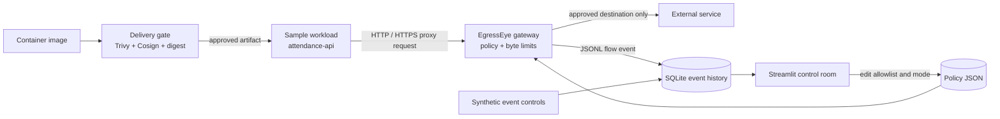

# EgressEye — The Container Network Watchdog

**Track:** Cloud · Secure Container Delivery  
**Project pitch:** EgressEye gives each container a known way out. It checks image trust before deployment, then watches and enforces outbound HTTP/HTTPS policy while the workload runs.

EgressEye combines the strongest ideas from the two starter projects:

- **DockRadar:** destination allowlists, severity rules, connection history, a simulator, and an investigation dashboard.
- **ContainerTrust:** scan, signature, and immutable digest checks before an image is trusted for deployment.

The result is a compact secure-delivery story: **verify the artifact, isolate the workload, mediate egress, explain every decision.**

## The real issue

A compromised service can use its normal network access to send data to a command server or a collection endpoint. Traditional perimeter monitoring can miss this when the application container has broad outbound access. Teams also need to distinguish a new legitimate dependency from suspicious behavior.

EgressEye applies a per-workload destination and port policy at an outbound gateway. It records the destination, transfer size, policy decision, and reason. In block mode, an unapproved HTTP/HTTPS destination is rejected before the gateway opens an upstream connection. Large transfers can also be cut off at the configured byte threshold. An alert is evidence to investigate, not proof that a workload is compromised.

## Architecture



Docker Compose places the workload and dashboard on an **internal-only** network. The proxy is the only service attached to both that network and the outbound network. The app has no published host port and cannot make a direct external TCP connection around the proxy. The dashboard is published on port 8501 for the local operator.

## Run the working demo

Requirements: Docker Desktop with Compose v2. The optional image delivery gate also needs Docker CLI, Trivy, and Cosign on the host.

From PowerShell in this folder:

```powershell
docker compose up --build -d
```

Open [http://localhost:8501](http://localhost:8501). Or run `.scripts\start.ps1`.

### Show the detection flow

1. In the sidebar, click **Generate normal activity**. These deterministic synthetic events should be classified as allowed.
2. Click **Generate suspicious activity**. A reserved documentation IP, an unapproved domain, and an approved host on the wrong port should create alerts and be blocked under the default policy.
3. Use **Attempt unapproved destination** to make the sample app send a real HTTPS CONNECT request through the gateway. The reserved `.example` hostname is rejected by policy before DNS or an upstream connection.
4. Use **Try approved destination** to make the sample app request `https://example.com/` through the gateway. This step needs outbound internet access; if the upstream is unavailable, EgressEye still records the allowed policy decision and connection error.
5. Open **Event stream** to filter proxy observations separately from simulator events.
6. Open **Egress policy** to change between `BLOCK` and `MONITOR`, adjust the byte threshold, or edit approved destinations. New proxy requests use the current policy immediately.

The generator is labeled **simulator** in the event stream. Live app requests are labeled **proxy**. That keeps a judge demonstration repeatable while showing which results came from an actual gateway connection.

### Example policy behavior

| Signal | Classification | Block mode |
|---|---|---|
| Approved host and port | Clear | Connect |
| Unknown hostname or raw IP | High | Reject before upstream connect |
| Approved hostname on an unapproved port | Medium | Reject before upstream connect |
| Transfer exceeds byte threshold | Severity increases | Stop forwarding once the limit is crossed |
| Same signals in monitor mode | Alert remains visible | Allow and record |

The initial allowlist includes `example.com` for the live probe, a few public package/API examples, and `db.internal.local:5432` as an application database example. Edit these to match your app. A wildcard such as `*.updates.example.com` matches subdomains, not the root `updates.example.com`.

## Secure delivery gate

The Streamlit **Container delivery** tab displays a report written by the host-side gate. It fails closed when a required scan, key, signature, or trusted digest is missing.

First build and push the image to a registry accessible to Docker, Trivy, and Cosign. Generate a demo signing key once and keep the private key out of source control:

```powershell
docker build -t REGISTRY/attendance-api:1.0 .\app
docker push REGISTRY/attendance-api:1.0
cosign generate-key-pair --output-key-prefix config/cosign
cosign sign --key config/cosign.key --tlog-upload=false REGISTRY/attendance-api:1.0
python delivery_gate.py baseline REGISTRY/attendance-api:1.0
python delivery_gate.py check REGISTRY/attendance-api:1.0
```

`baseline` records the digest only after verifying the image signature. `check` pulls the current image, scans vulnerabilities and secrets with Trivy, verifies the signature, compares the immutable digest to the trusted baseline, evaluates `config/delivery_policy.json`, and writes `data/delivery_report.json` for the dashboard. Retagging a different image under the same tag changes the digest and blocks delivery.

Never commit `config/cosign.key`. The sample workflow uses a local demo key and disables transparency-log upload; production signing should use managed keyless identity or a protected key service and an auditable transparency log.

## Stop and reset

```powershell
docker compose down
```

This stops the services and preserves local policy and event history. Use **Clear event history** in the dashboard to reset observations. `docker compose down -v` is not required.

## Security boundaries and production path

- The proxy enforces **TCP HTTP and HTTPS** requests that use its forward-proxy endpoint. HTTPS is tunneled with CONNECT; EgressEye does not decrypt TLS content.
- In this demo, the internal-only Docker network prevents the sample workload from opening direct external TCP connections. The gateway is the only service with outbound network access.
- UDP, QUIC/HTTP3, and arbitrary protocols are outside the proxy protocol. A production deployment should also enforce the egress boundary with a Kubernetes CNI policy or egress gateway (for example, Cilium/Calico), then ingest its flow telemetry.
- DNS/IP reputation, workload identity from an orchestrator, per-namespace policy, durable event transport, and high availability are production extensions. The current policy is hostname/port based and history is local SQLite.
- The delivery gate requires registry reachability and the host tools noted above. The live allow probe requires outbound internet access. The rest of the UI and synthetic detector demo run locally.

## Project map

| File | Responsibility |
|---|---|
| `dashboard.py` | Overview, investigation, policy editor, delivery report |
| `egress_proxy.py` | HTTP/HTTPS forward proxy, block decisions, byte counters |
| `policy.py` | Policy validation, wildcard matching, severity rules |
| `detector.py` | JSONL ingestion, deduplication, SQLite history |
| `simulator.py` | Repeatable labeled demo events |
| `app/app.py` | Sample attendance-service workload and live probes |
| `delivery_gate.py` | Host-side Trivy, Cosign, and digest admission check |
| `docker-compose.yml` | Isolated workload network and outbound gateway topology |
